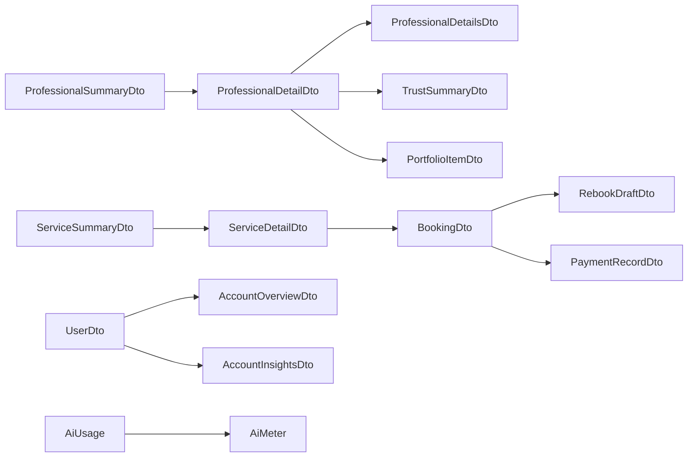

# API and Data Reference (as used by the Android app)

Base URL `https://api.servix.name.ng/api/v1/` (`app/build.gradle.kts:19`). Interface:
`data/network/ServixApiService.kt`. Every request carries `Authorization: Bearer <access token>`
when signed in, a native client header and User-Agent (`ServixNetworkModule.kt`,
`ClientUserAgent.kt`). Error envelope `{error:{status,code,message,errors?}}` →
`ServixApiException` (`data/model/AuthModels.kt`). No secrets are embedded in the app; OAuth uses
server-issued tickets.

## 1. Endpoints the app calls

| Area | Method & path | Used by | Notes |
| --- | --- | --- | --- |
| Auth | `POST auth/register`, `POST auth/login` | S3/S4 | returns `{user, accessToken}` **or** `{security}` |
| | `POST auth/refresh`, `POST auth/logout`, `GET me` | network module, Account | refresh via cookie jar |
| | `GET auth/verification-method`, `POST auth/verify-email/code {code}`, `POST auth/verify-email/resend` | S5 | |
| | `POST auth/forgot-password {email}` | S7 | |
| | `GET auth/oauth/config`, `POST auth/oauth/native/exchange {ticket}` | Welcome/Login/Register | providers list; callback scheme `ng.name.servix.app://oauth/callback` |
| Security | `GET auth/security/config`; `POST auth/security/{status, email/verify, email/resend, totp/setup, totp/enroll, totp/verify, recovery/codes, recovery/verify, finish, reset-password, cancel}` | S6 | server returns `SecurityFlowState{stage,email,passwordPolicy,…}` |
| Catalogue | `GET categories` | Home, Explore, AI | cached in memory |
| | `GET stats` | repository method only (`CatalogueRepository.kt:54`), **no caller in UI** | 🟠 |
| | `GET professionals?q&category&location&minRating&maxPrice&availability&available&sort&page&pageSize` | Home (sort=rating, 6), Explore | `ProfessionalsPageResponse{items,total,page,pageSize}` |
| | `GET professionals/{slug}`, `/services`, `/reviews`, `/availability/summary` | S10 | |
| | `GET services?…same filters…`, `GET services/{slug}`, `/reviews`, `/availability?days=14` | Explore, S11 | |
| | `POST views {type, slug}` | S10/S11 | fire-and-forget |
| Saved | `GET account/saved`, `POST account/saved {profileSlug}`, `DELETE account/saved/{slug}` | S10, Account Saved | |
| Bookings | `POST bookings {serviceId, scheduledAt, notes?, rebookedFrom?}` (+ `Idempotency-Key`) | booking sheet | |
| | `POST bookings/{id}/pay` → `{authorizationUrl, reference}` | sheet / S13 | Paystack |
| | `GET bookings`, `GET bookings/{id}` | S8, S12, S13 (2-s polling after pay) | |
| | `POST bookings/{id}/cancel {reason?}`, `/confirm`, `/dispute {reason}`, `/review {rating, text?}` | S13 modals | |
| | `GET bookings/{id}/rebook` → `RebookDraftDto` | Book again | |
| Account | `GET account/overview` | Home plan line | `AccountOverviewDto` |
| | `GET account/insights`, `GET account/payments` | **fetched by repo only, no UI on main** | 🟠 |
| | `GET account/security-summary` | Security panel | `{method, recoveryCodesRemaining, passkeys}` |
| | `GET account/device` | DeviceCard | `{ip, device, os, client, userAgent, seenAt}` |
| | `PATCH account/profile {fullName?, avatarUrl?}` | Profile panel | |
| | `POST uploads?kind=avatar&fileName=… (raw body, Content-Type)` → `{url,key,kind}` | Profile photo | |
| | `GET billing/plan` | Plan panel | parsed as raw JSON |
| | `GET me/entitlements` | **declared, never called** | 🟠 |
| Notifications | `GET account/notifications?before&unread`, `GET account/notifications/unread`, `POST account/notifications/read {ids?|all?}` | S15, shell badge, worker | |
| AI | `POST ai/assistant/stream {messages[]}` (SSE: `start|delta|done|error`; raw OkHttp call in `AiRepository.kt:43`), fallback `POST ai/assistant`, `GET ai/usage` (`enabled` gates the tab), `POST ai/pricing/guidance {category, days?, brief?}`, `POST ai/feedback` | S14 | dedicated long-timeout client |
| Updates (external) | `GET https://api.github.com/repos/toluenetech-spec/servix-android/releases?per_page=10` | self-update (test channel) | asset URL must be under the repo's `/releases/` |

`ServixApiService.kt` declares **63 routes**. Declared but not reached from any screen on `main`:
`GET me/entitlements` (no caller at all), `GET stats`, `GET account/insights`, `GET account/payments`
(repository methods exist, no UI calls them).

**Not declared at all:** `GET features` (feature flags), anything under `community/*`,
`requests/*`, `proposals/*`, `admin/*`, professional dashboard routes.

## 2. Core data models (`data/model/*`)

| Model | Fields (abbreviated) |
| --- | --- |
| `UserDto` | id, email, fullName, avatarUrl?, role, status, kycStatus?, emailVerified, createdAt?; derived `firstName` |
| `AccountOverviewDto` | kind, emailVerified, plan, canManageServices, needsChoice, applicationStatus?, kycStatus? |
| `CategoryDto` | id (= slug), name, description, serviceCount, icon |
| `ProfessionalSummaryDto` | id (= slug), name, title, location, categoryId, rating, reviewCount, startingPrice, verified, completedProjects, responseTime, memberSince, availability, image?, plan, availableNow |
| `ProfessionalDetailDto` | all summary fields + about, skills[], serviceIds[], portfolio[] (`PortfolioItemDto`), details? (`ProfessionalDetailsDto`: occupation, website, languages[], education[], certifications[], experience[]), verifiedProjects, trust? (`TrustSummaryDto`) |
| `TrustSummaryDto` | servixVerified, identityVerified, completedJobs, verifiedProjects, accountAgeDays?, reliability?, responseRate?, repeatCustomers? (`TrustMetricDto`: enough, percent?, measurable?, minimum?, medianHours?, customers?), rating? (`TrustRatingMetricDto`), achievements[] |
| `ServiceSummaryDto` / `ServiceDetailDto` | id (= slug), title, price, priceUnit, rating, reviewCount, image?, professional{…}; detail adds description, gallery[], included[], needs[], faqs[], deliveryDays, duration, revisions, availability, document/video links (fields inferred from screen usage) |
| `BookingDto` | id, reference, status, serviceTitle, professional name/slug, service slug, scheduledAt, price, notes, hasReview, createdAt (inferred from usage) |
| `RebookDraftDto` | previousBookingId, previousStatus, professional{id,name,image?}, services[]{id,title,price,priceUnit,deliveryDays?,wasBooked}, previousServiceAvailable, previousNotes |
| `NotificationDto` | id, type, title, body, link?, readAt?, createdAt; list `{unread, before?, items[]}` |
| `PaymentRecordDto` | id, reference, amount, currency, status, createdAt, booking{id, reference, serviceTitle}; derived amountNaira |
| `AccountInsightsDto` | statusCounts{}, monthly[]{month, spent, refunded}, upcoming[]{id, reference, serviceTitle, scheduledAt, status}, pendingReviews; derived totalSpentNaira, totalRefundedNaira |
| `SecuritySummaryDto` | method?, recoveryCodesRemaining, passkeys |
| `AccountDeviceDto` | ip?, device?, os?, client?, userAgent?, seenAt? |
| `AiUsage` / `AiMeter` | planLabel?, subject?, meter{used, reserved, allowed?, remaining?, percent?, level?, resetAt?} |
| `AiAnswer` / `AiStreamEvent` | answer, ai{model?, fallbackUsed, durationMs?, quota?}; stream `type` start/delta/done/error with text/answer/code/message/status |
| `AiPricingResponse` | summary, rangeLow, rangeHigh, basis, stats, tips[] |
| `ServixApiException` | status, code?, message, fieldErrors{}, meta{}, isNetworkError |

Sources: `CatalogueModels.kt`, `BookingModels.kt`, `AccountModels.kt`, `AiModels.kt`,
`NotificationModels.kt`, `AuthModels.kt`.

## 3. Booking status vocabulary

`pending_payment, requested, accepted, in_progress, delivered, completed, cancelled, declined,
disputed, refunded` — labels in `strings.xml` (`status_*`) and `BookingStatusMeta.kt`.

## 4. Local persistence

| Store | Contents | Source |
| --- | --- | --- |
| `TokenStore` (EncryptedSharedPreferences) | access token, user snapshot | `data/local/TokenStore.kt` |
| `PersistentCookieJar` | refresh cookie | `data/network/PersistentCookieJar.kt` |
| `TermsAcceptanceStore` | terms accepted flag/time | `data/local/TermsAcceptanceStore.kt` |
| DataStore `city` | chosen/nearest city | `location/LocationButton.kt:40` |
| DataStore `updates` | last check time, cached release | `updates/Updates.kt:30` |
| `NotificationPrefs` | permission asked, last seen ids | `notifications/NotificationPrefs.kt` |
| In-memory | categories cache, AI turns (≤20) | `CatalogueRepository`, `AiViewModel` |

## 5. Feature flags (platform) relevant to a redesign

`GET /features` on the API returns booleans for `requests, compare, achievements, trust,
projects, crm, packages, business, pricing, community, ai` (servix repo `api/src/lib/features.ts`).
The app does not read them today; the approved Release 1.1 plan requires gating Chats on
`community` and Post-a-request on `requests` at runtime.

## 6. Permissions declared (`AndroidManifest.xml`)

`INTERNET`, `ACCESS_NETWORK_STATE`, `ACCESS_COARSE_LOCATION` (city only, on demand),
`POST_NOTIFICATIONS` (Android 13+). Test builds additionally request install-packages permission
at install time for self-update (`res/xml/update_paths.xml`, `FileProvider`).
