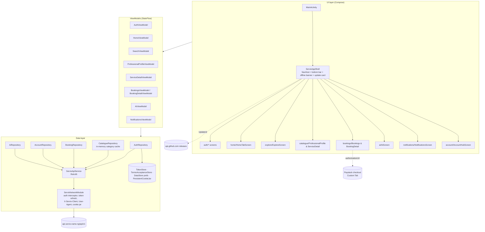
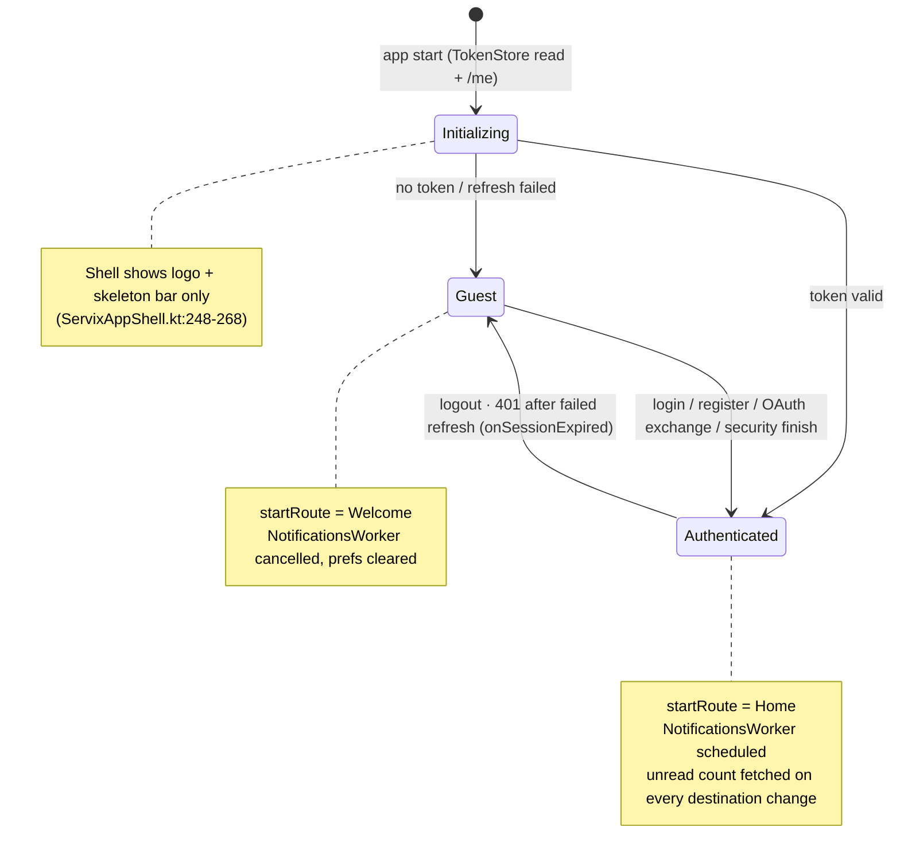
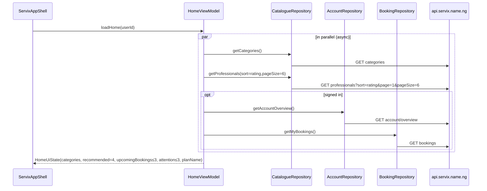

# Application Architecture

Source basis: `app/src/main/java/ng/name/servix/app/**` at `61a1c83`. Path prefixes below are
relative to that package root.

## 1. Technology stack

| Concern | Choice | Evidence |
| --- | --- | --- |
| Language / UI | Kotlin 2.x, Jetpack Compose, Material 3 | `app/build.gradle.kts:100-121` |
| Navigation | `androidx.navigation:navigation-compose` 2.8.5 with **type-safe `@Serializable` routes** | `ui/navigation/ServixRoutes.kt` |
| State | `ViewModel` + `StateFlow`, one `UiState` data class per screen | e.g. `ui/home/HomeViewModel.kt`, `ui/catalogue/SearchScreen.kt:147` |
| Networking | Retrofit 2.11 + OkHttp 4.12 + kotlinx-serialization | `data/network/ServixApiService.kt`, `ServixNetworkModule.kt` |
| Images | Coil 2.7 with a **separate** OkHttp client that never carries auth tokens | `MainActivity.kt:47-50` |
| Persistence | DataStore Preferences (city, update check, notification prefs); `EncryptedSharedPreferences` for tokens | `data/local/TokenStore.kt`, `location/LocationButton.kt:40`, `updates/Updates.kt:30` |
| Background | WorkManager periodic job (15 min) for notification polling | `notifications/NotificationsWorker.kt:50` |
| Web hand-offs | Chrome Custom Tabs (Paystack, Terms/Privacy, website) | `util/CustomTabLauncher.kt` |
| DI | Hand-rolled singleton `AppContainer` (no Hilt/Koin) | `di/AppContainer.kt` |
| Self-update | GitHub Releases API + DownloadManager + `FileProvider` installer (test channel only) | `updates/Updates.kt` |

## 2. Layered view



## 3. Composition root and dependency wiring

`di/AppContainer.kt` builds, in order: `ConnectivityObserver`, `TokenStore`, `TermsAcceptanceStore`,
`PersistentCookieJar`, `AuthRepository`, `ServixNetworkModule` (with callbacks
`onSessionRefreshed` / `onSessionExpired` back into `AuthRepository`), then `AiRepository`,
`CatalogueRepository`, `BookingRepository`, `AccountRepository` (all taking a lazy
`apiProvider`). `MainActivity` passes the repositories into `ServixAppShell`; the shell creates
all ViewModels with factories (`ServixAppShell.kt:214-226`).

## 4. Session & auth state machine

`AuthViewModel.sessionState` drives the whole shell (`ServixAppShell.kt:248-270`):



Post-authentication routing (`PostAuthDestination` in `AuthViewModel.kt:21`):
`DASHBOARD` → Home, `VERIFY_EMAIL` → VerifyEmail, `SECURITY_CHECK` → SecurityCheck. Login and
register both navigate to **SecurityCheck** first when the API returns a `security` object
(production has MFA on), otherwise to Home (`ServixAppShell.kt:480-560`).

## 5. Networking details

- Base URL from `BuildConfig.API_BASE_URL`; every request carries a native client identifier and a
  custom User-Agent (`data/network/ClientUserAgent.kt`, `ServixNetworkModule.kt`).
- An OkHttp `Authenticator` performs a single-flight `POST auth/refresh` on a dedicated client and
  gives up after the second 401 (`ServixNetworkModule.kt:65-95, 190`); on failure it signals
  session expiry (`AppContainer.kt:30-38`).
- Cookies (refresh cookie) persist in `PersistentCookieJar`.
- Errors are normalised to `ServixApiException(status, code, message, fieldErrors, meta,
  isNetworkError)` by `data/network/ApiErrorParser.kt` from the backend envelope
  `{error:{code,message,status,errors}}` (`data/model/AuthModels.kt`).
- HTTP logging is `BASIC` level only (no bodies) (`ServixNetworkModule.kt:159-160`).
- Servix AI uses a dedicated longer-timeout client and a raw OkHttp SSE call to
  `ai/assistant/stream` with fallback to Retrofit `ai/assistant` (`AiRepository.kt:32-60`,
  `data/network/AiStream.kt`).
- Images: Coil with its own client; `android:usesCleartextTraffic="false"` and a
  `network_security_config` (`AndroidManifest.xml`).

## 6. Data flow for one screen (Home)


(`ui/home/HomeViewModel.kt:92-145`)

## 7. Cross-cutting behaviours

| Behaviour | Implementation |
| --- | --- |
| Offline | `util/ConnectivityObserver.kt` → `OfflineBanner` in the shell top bar (`ServixComponents.kt:342`); screens keep last data |
| Deep links | `servix://booking/<id>`, `servix://notifications` (notification taps) and `ng.name.servix.app://oauth/callback` (provider sign-in) — `AndroidManifest.xml`; dispatched through `util/AppLinkBus.kt` / `util/OAuthReturnBus.kt` |
| Notifications | Local notifications built by `notifications/ServixNotifier.kt` from polled unread items; permission rationale dialog on Android 13+ (`ServixAppShell.kt:348-366`) |
| Motion | Shared-axis X push transitions 220 ms; press feedback scale 0.98; respects animator duration scale (`ui/motion/Motion.kt`) |
| Accessibility | Touch target test (`app/src/test/.../a11y/TouchTargetTest.kt`), font-scale 1.3 screenshots, `ui/a11y/A11y.kt` |
| Self-update | Only in the GitHub test channel (`SELF_UPDATE_CHANNEL = "github"`); Play builds set `"none"` (`app/build.gradle.kts:60-67`) |
| Terms acceptance | Stored locally in `data/local/TermsAcceptanceStore.kt` at registration |

## 8. Module/package map

```
ng.name.servix.app
├── MainActivity.kt            splash, edge-to-edge, Coil, intent → buses
├── di/AppContainer.kt
├── data/{local,model,network,repository}
├── location/                  city DataStore, LocationButton (coarse location → nearest Nigerian city)
├── notifications/             WorkManager poller, notifier, prefs
├── updates/                   GitHub release check, download, install, UpdateCard
├── util/                      formatters (₦, dates), Custom Tabs, buses, connectivity
└── ui/
    ├── navigation/            ServixRoutes, ServixAppShell (NavHost, bottom bar, dead Stage1AccountTab)
    ├── theme/                 Color, Type (Inter), Theme (light only), shapes
    ├── motion/, a11y/
    ├── components/            ServixComponents, MobileComponents, ComponentGallery
    ├── auth/                  Welcome, Login, Register, VerifyEmail, SecurityCheck, ForgotPassword (+ AuthViewModel)
    ├── home/, explore/, catalogue/, bookings/, ai/, notifications/, account/
```

## 9. Known structural debts (facts, not proposals)

- `Stage1AccountTab` in `ServixAppShell.kt:1038+` is **unreachable** (the Account route renders
  `AccountHubScreen`); it is the only place `ProfessionalToolsWebCard` is used.
- `SearchScreen.kt` keeps the `SearchViewModel`, filter option tables and an older
  `SearchScreen` composable; the live Explore tab renders `ExploreScreen` (`ServixAppShell.kt:700`).
- Payment history and account insights are fetched by `AccountRepository` (`:50`, `:72`) and have
  sheet composables (`AccountSheets.kt:157`) but no entry point in the current Account hub.
- The app never calls `GET /features`, so platform feature flags are not consulted (confirmed by
  the Stage 0 audit on PR #4, `docs/ia/IA_AUDIT.md`).
