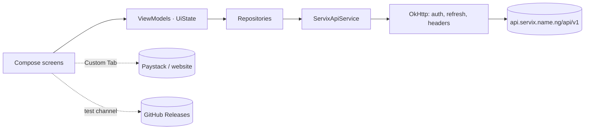
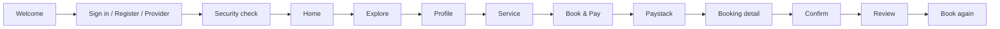

# Servix Android — Master Design Document for Google Stitch

Snapshot of the shipped Android app `ng.name.servix.app` 1.0.0 (versionCode 100),
repository `toluenetech-spec/servix-android@61a1c83`, prepared 2026-11-07. This file is the single
entry point; every section links to the detailed document it summarises. Status marks:
✅ implemented · 🟠 partial · 🟡 in flight (PR #4) · ⚪ platform-only (web) · ⛔ not implemented.

---

## 0. Read this first — existing vs. proposed (instruction to Stitch)

**Only items marked ✅ exist in the app that users have today.** Everything else in this package
describes code that is unreachable (🟠), a pull request that is not merged or released (🟡), a web
feature with no Android screen (⚪), or a plan (⛔).

- Do **not** treat any 🟡 image in `screenshots/in-flight-pr4/` as the current app. Those are
  prototype renders from PR #4's IA audit; the shipped bottom bar is still Home · Explore ·
  Bookings · Servix AI · Account (`screenshots/in-flight-pr4/ia_00_bottom_bar_before.png` = today).
- Do **not** treat `screenshots/play-listing/` as pixel-exact UI; they are store images rendered by
  the same harness at 1080×1920 for Google Play.
- All renders use **fixture data** (sample names, prices, bookings); none are production data or
  device captures. See `screenshots/SCREENSHOT_INDEX.md`.
- When designing a 🟡/⚪ surface (Chats, Network, Requests, role-aware Home), label the frame
  "NEW — Release 1.1" so engineering never mistakes it for a restyle of an existing screen.
- When a requirement in `STITCH_DESIGN_REQUIREMENTS.md` conflicts with a current screen, the
  requirement wins, but the frame must still be labelled as a change, not a restyle.

### 0.1 Feature status at a glance (full detail in `FEATURE_CATALOG.md`)

| Category | Items |
| --- | --- |
| **✅ Implemented on `main`** | Welcome · email/password + Google/GitHub sign-in · registration with checklist and Terms · email OTP/link verification · server-driven MFA security check (email, TOTP enrol, recovery codes, finish, reset password) · forgot password · Home dashboard (attention, upcoming bookings, categories, recommended, AI card, plan line) · Explore with filters/sort/infinite scroll · professional profile (tabs, trust, save) · service detail (gallery, FAQ, availability) · booking sheet → Paystack Custom Tab → 2-s/90-s polling · Bookings Active/Past grouped · booking detail with cancel/confirm/dispute/review/re-book · Servix AI assistant (SSE) + feedback + budget guide + usage meter · notifications centre + 15-min poll + deep links · Account hub: profile name/photo, saved, plan (read-only), security (read-only), device panel, updates, legal, sign out · offline banner · self-update (test channel) |
| **🟠 Partially implemented** | payment history & spend insights (fetched/modelled, no screen) · platform stats (`GET stats`, no caller) · `GET me/entitlements` (declared, never called) · `AccountOverviewDto` role/KYC fields (fetched, not rendered) · video/PDF gallery items (links out, no in-app player) · AI conversations (memory only, lost on restart) |
| **🟡 Planned / in flight** | PR #4: 1.0.1 profile-photo fix, `ServixBottomBar` with centre **Chats**, role-aware Home/Account prototypes · Release 1.1 stages: Chats (threads, realtime, media, voice, replies, reactions), Servix AI pinned in Chats, Network/connections, job requests & proposals (flag-gated), FCM push later |
| **⚪ Web-only (not in the app)** | professional workspace (gigs, availability, earnings, proposals, team, analytics, KYC) · admin console · compare · plan upgrade/checkout · password/MFA/passkey management · account deletion · chat/network/requests today |
| **⛔/🗑 Unreachable or deprecated in the codebase** | `Stage1AccountTab` (`ServixAppShell.kt:1038+`) · `ProfessionalToolsWebCard` · `AccountPaymentsSheetContent` / `AccountSecuritySheetContent` · older `SearchScreen` composable · `ComponentsGallery` (harness only) · unused strings `dashboard_*`, `nav_dashboard`, `nav_search`, `home_hero_*`, `home_how_*`, `home_stats_live_note`, `search_pros_*`, `pro_tools_on_web*` · dark theme, tablets, FCM, biometrics (never built) |

---

## 1. Product in one paragraph  → `SERVIX_PRODUCT_OVERVIEW.md`

Servix is a Nigerian marketplace for professional services. The Android app lets **customers**
discover verified professionals, compare services with upfront Naira pricing, book a slot, pay
through Servix (Paystack), track the job, confirm completion to release payment, review, and
re-book — plus a **Servix AI** assistant and budget guide, notifications, saved professionals and
a read-only account area. Professionals and admins can sign in but get the customer experience;
their tools live on the website. The app is a thin client of the production API
`api.servix.name.ng`.

## 2. Architecture  → `APPLICATION_ARCHITECTURE.md`

Kotlin · Jetpack Compose · Material 3 (light only) · type-safe Navigation Compose · ViewModel +
StateFlow · Retrofit/OkHttp/kotlinx-serialization · Coil · DataStore + EncryptedSharedPreferences
· WorkManager (15-min notification poll) · Chrome Custom Tabs (Paystack, web, OAuth) · hand-rolled
`AppContainer` DI · GitHub-Releases self-update for test builds.

## 3. Screens  → `SCREEN_INVENTORY.md`, `SCREEN_SPECIFICATIONS.md`

| ID | Screen | Status | Render |
| --- | --- | --- | --- |
| S1 | Splash / initialising | ✅ | — |
| S2 | Welcome | ✅ | `screenshots/app-renders/01_welcome.png` |
| S3 | Sign in | ✅ | `02_sign_in.png` |
| S4 | Create account | ✅ | — |
| S5 | Verify email (OTP / link) | ✅ | — |
| S6 | Security check (MFA stages) | ✅ | `18_security_check_step.png` |
| S7 | Forgot password | ✅ | — |
| S8 | **Home (dashboard)** | ✅ | `03_home_signed_in.png`, `04_home_guest.png`, `05_home_bookings.png` |
| S9 | **Explore** (+ Filters sheet, Sort menu) | ✅ | `06_explore_results.png`, `07_explore_empty.png` |
| S10 | Professional profile (+ Choose-a-service sheet) | ✅ | `08_professional_profile.png` |
| S11 | Service detail (+ Booking sheet) | ✅ | `09_service_detail.png` |
| S12 | **Bookings** | ✅ | `10_bookings_grouped.png` |
| S13 | Booking detail (+ 5 action modals) | ✅ | `11_booking_pending_payment.png`, `12_booking_requested.png`, `13_booking_completed.png` |
| S14 | **Servix AI** (Assistant · Budget guide) | ✅ | `14_ai_chat.png`, `14b_ai_empty.png` |
| S15 | Notifications | ✅ | `16_notifications.png` |
| S16 | **Account** hub + 7 panels | ✅ (Plan/Security read-only) | `15_account.png`, `17_plan.png` |
| — | Payments history / insights | 🟠 data only, no entry | — |
| — | Chats · Network · Requests · role-aware Home | 🟡 PR #4 / Release 1.1 | `screenshots/in-flight-pr4/` |
| — | Pro/admin workspaces, compare, plan checkout, MFA settings | ⚪ web | — |

Bold = bottom-bar tabs (Home · Explore · Bookings · Servix AI · Account).

## 4. Roles  → `USER_ROLES_AND_PERMISSIONS.md`

Guest (browse + inline sign-in prompts) · Customer (everything above) · Professional / Admin
(identical to customer + role badge; tools on web). Approved but unshipped direction: role-aware
Home/Account and a centre **Chats** tab.

## 5. Journeys  → `USER_JOURNEYS.md`

J1 first run → auth → security → Home · J2 discover → book → Paystack → polling · J3 booking
lifecycle (10 statuses, customer actions) · J4 needs-attention loop · J5 re-book · J6 Servix AI ·
J7 notifications · J8 account · J9 password recovery · J10 self-update.

## 6. Features  → `FEATURE_CATALOG.md`

60+ catalogued items across auth, discovery, bookings/payments, AI, notifications, account/device,
professional tooling, community/marketplace and platform quality — each with status, source path
and screenshot.

## 7. Dashboards  → `DASHBOARDS_AND_ANALYTICS.md`

One dashboard: Home (greeting, bell, search, needs-attention ≤3, active bookings ≤3, categories,
recommended, AI card, plan/usage). Spend insights, payment history and platform stats are fetched
or modelled but **not shown**. No professional or admin dashboards in the app.

## 8. Navigation  → `NAVIGATION_MAP.md`

5 tabs with per-tab state restore; auth stack without bar; stack reset on auth/sign-out; deep links
`servix://booking/{id}`, `servix://notifications`, `ng.name.servix.app://oauth/callback`; Custom
Tab hand-offs for pay, legal, website, provider sign-in.

## 9. Design system  → `DESIGN_SYSTEM_AUDIT.md`

Palette Deep Forest `#12372A` · Forest Green `#1F5C45` · Warm Ivory `#F7F4EC` · Soft Sand
`#EDE8DC` · Coral `#E56B5D` · Charcoal `#202622` · Muted Gray `#68716B` (+ Border Sand, Danger Red).
Inter 400–700; 14-step Material type scale; radii 16/24/12; buttons 52 dp; cards flat; motion
220/250/150/120 ms; ~45 reusable composables. 12 audit findings (hex mismatch, "escrow" copy,
inline strings, residue strings, duplicate entry points, etc.).

## 10. API & data  → `API_AND_DATA_REFERENCE.md`

63 routes declared across auth, security, catalogue, saved, bookings, account, notifications, AI
(59 reached from screens), plus GitHub releases; models for user, catalogue, booking, account, notification, AI; local stores;
platform feature flags (unused by the app today).

## 11. Requirements for the redesign  → `STITCH_DESIGN_REQUIREMENTS.md`

R1 no landing page, Home = dashboard · R2 native, non-generic, light, no gradients · R3 exact
palette · R4 Chats centre tab (Home · Explore · Chats · Bookings · Account) · R5 role-specific
content (per-role block lists still pending sign-off) · R6 AI pinned in Chats + Home shortcut · R7
bell-only notifications · R8 no "escrow" wording · R9 one price per service · R10 registration fields · R11 keep MFA
stages · R12 keep device panel + self-update · R13 no pro/admin workspaces this release · R14 never
show unshipped features as live. Plus per-screen parity lists, required states, technical envelope
and a verbatim-safe Stitch preamble.

## 12. Traceability  → `IMPLEMENTATION_TRACEABILITY.md`

Screen ↔ composable:line ↔ ViewModel ↔ endpoints ↔ tests (14 files / 67 tests) ↔ renders; doc-vs-code
gaps.

## 13. Evidence  → `screenshots/SCREENSHOT_INDEX.md`, `INVESTIGATION_REPORT.md`

44 PNGs in three separate folders: `app-renders/` 27 CI renders of the real screens on `main`
(fixture data), `play-listing/` 8 Play Store images (promotional, fixture data), `in-flight-pr4/` 9
PR #4 prototypes (unshipped). Investigation method, limitations (no runtime, no new captures) and
findings summary are in the report.

---

### How to brief Stitch

1. Give Stitch this file and the `screenshots/` folder.
2. For each screen ID, point Stitch at the matching section of `SCREEN_SPECIFICATIONS.md` (what
   must remain) and the render (how it looks now).
3. Apply `STITCH_DESIGN_REQUIREMENTS.md` §1–§4 as hard constraints; use §6 as the prompt preamble.
4. Treat anything marked 🟠/🟡/⚪/⛔ as "design as new, label as new" or "out of scope".
