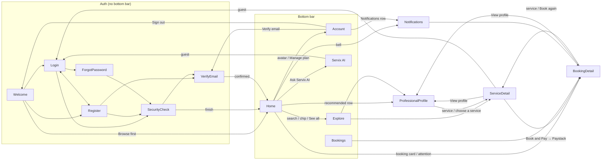

# Navigation Map

Source: `ui/navigation/ServixRoutes.kt`, `ui/navigation/ServixAppShell.kt`, `AndroidManifest.xml`.

## 1. Bottom navigation (on `main`)

| Position | Label (`strings.xml`) | Route | Icons (Material) | Selected also when on | testTag |
| --- | --- | --- | --- | --- | --- |
| 1 | Home (`nav_home`) | `Home` | `Home` filled/outlined | — | `nav_tab_home` |
| 2 | Explore (`nav_explore`) | `Search` | `Search` | `ProfessionalProfile`, `ServiceDetail` | `nav_tab_search` |
| 3 | Bookings (`nav_bookings`) | `Bookings` | `CalendarMonth` | `BookingDetail` | `nav_tab_bookings` |
| 4 | Servix AI (`nav_ai`) | `ServixAi` | `AutoAwesome` | — | `nav_tab_ai` |
| 5 | Account (`nav_account`) | `Account` | `AccountCircle` | — | `nav_tab_account` |

- Same five tabs for guests and signed-in users (`ServixAppShell.kt:189`).
- Hidden on auth routes (`Welcome, Login, Register, VerifyEmail, SecurityCheck, ForgotPassword`).
- Tab taps use `popUpTo(startDestination){saveState} + launchSingleTop + restoreState`
  (`:404-410`) — each tab keeps its own state.
- Style: `NavigationBar` on Warm Ivory, 1 dp Border Sand divider above, selected Deep Forest with
  Soft Sand indicator, unselected Muted Gray, `labelSmall` labels (`:376-425`).
- 🟡 PR #4 replaces this with `ServixBottomBar.kt`: Home · Explore · **Chats** (centre) ·
  Bookings · Account (`screenshots/in-flight-pr4/ia_01_bottom_bar_after.png`).

## 2. Navigation graph

## 3. Route parameters

| Route | Params | Set by |
| --- | --- | --- |
| `ProfessionalProfile(slug)` | professional slug | Home, Explore, ServiceDetail, BookingDetail |
| `ServiceDetail(slug, rebookedFrom?, initialNotes?, openBookingSheet=false)` | re-book draft fields | Explore, profile, BookingDetail (Book again), profile "Choose a service" (`openBookingSheet=true`) |
| `BookingDetail(id, pollingAfterPay=false)` | booking id; start 2-s polling | Bookings, Home, Notifications, deep link, post-payment |

## 4. Back-stack and reset rules

| Event | Behaviour | Source |
| --- | --- | --- |
| Successful auth (login/register/OAuth/security finish) | `navigate(target){popUpTo(0){inclusive}}` — the whole stack is replaced by Home (or the pending post-auth route) | `:228-234, 331-333` |
| Sign out | stack replaced by Welcome | `:1024-1030` |
| Back on Login/Register | → Welcome (`popUpTo(0)`) | `:511-516, 547-552` |
| Guest hits a gated action | in-place prompt or `navigate(Login)`; `pendingPostAuthRoute` remembers the service sheet | `:224-236, 837-858` |
| Not-found states | offer "Browse all professionals/services" → Explore | profile/service screens |
| Predictive back | `android:enableOnBackInvokedCallback="true"` | manifest |

Transitions: shared-axis X (slide ¼ in, 1⁄12 out, 220 ms, `FastOutSlowInEasing`), reduced when the
system animator scale is 0 (`:432-460`, `ui/motion/Motion.kt`).

## 5. External hand-offs (Chrome Custom Tabs)

| Trigger | URL |
| --- | --- |
| Pay | Paystack `authorizationUrl` from `POST bookings/{id}/pay` |
| Terms / Privacy | `https://www.servix.name.ng/terms`, `/privacy` |
| Apply as professional | `https://www.servix.name.ng/professionals/join` |
| Manage plan / security / account | `https://www.servix.name.ng` (`/dashboard/...`) |
| Provider sign-in | API `auth/{google|github}/native/start?client=ng.name.servix.app` |
| Professional website link | `ProfessionalDetailsDto.website` |
| Service video / PDF | website media URL |
| Security disabled fallback | `https://www.servix.name.ng/login` |

## 6. Deep links into the app

| URI | Handler | Destination |
| --- | --- | --- |
| `ng.name.servix.app://oauth/callback?provider=&ticket=` | `OAuthReturnBus` → `AuthViewModel.handleOAuthReturn` | Home / SecurityCheck / VerifyEmail |
| `servix://booking/<id>` | `AppLinkBus` | `BookingDetail(id)` |
| `servix://notifications` | `AppLinkBus` | `Notifications` |

`MainActivity` is `singleTask`, so links arrive via `onNewIntent` (`MainActivity.kt:28-35`).

## 7. In-screen navigation (not NavHost)

- Account hub panels switch an `AccountPanel` state in place with "← Back to account"
  (`AccountHubScreen.kt:70, 165`).
- Professional profile tabs (`ProfileTab`) and Servix AI sub-tabs ("Assistant" / "Budget guide")
  are local state.
- Bookings Active/Past pills are local state (`BookingsListTab`).
