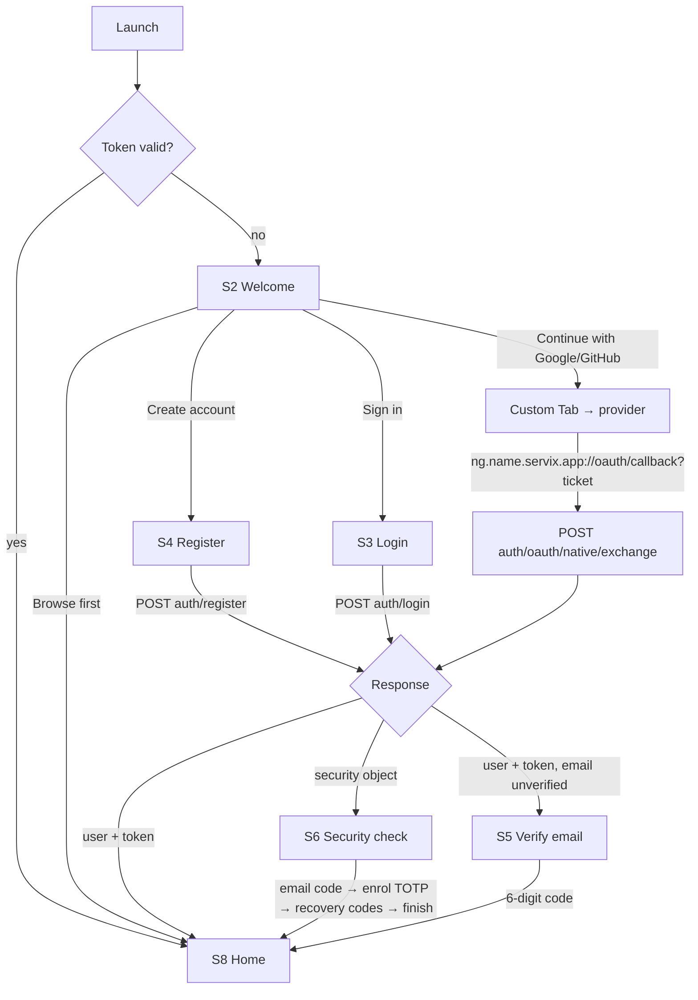
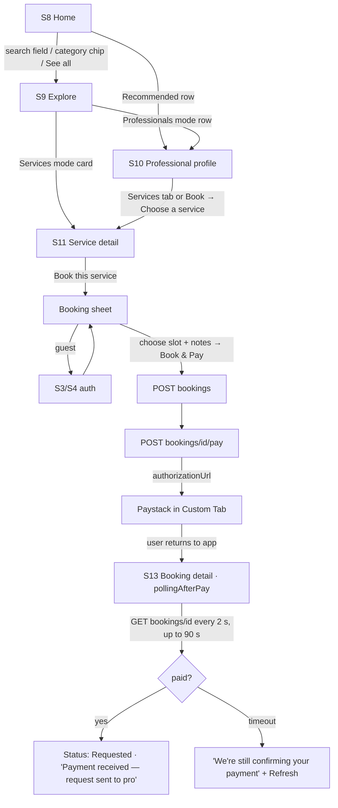
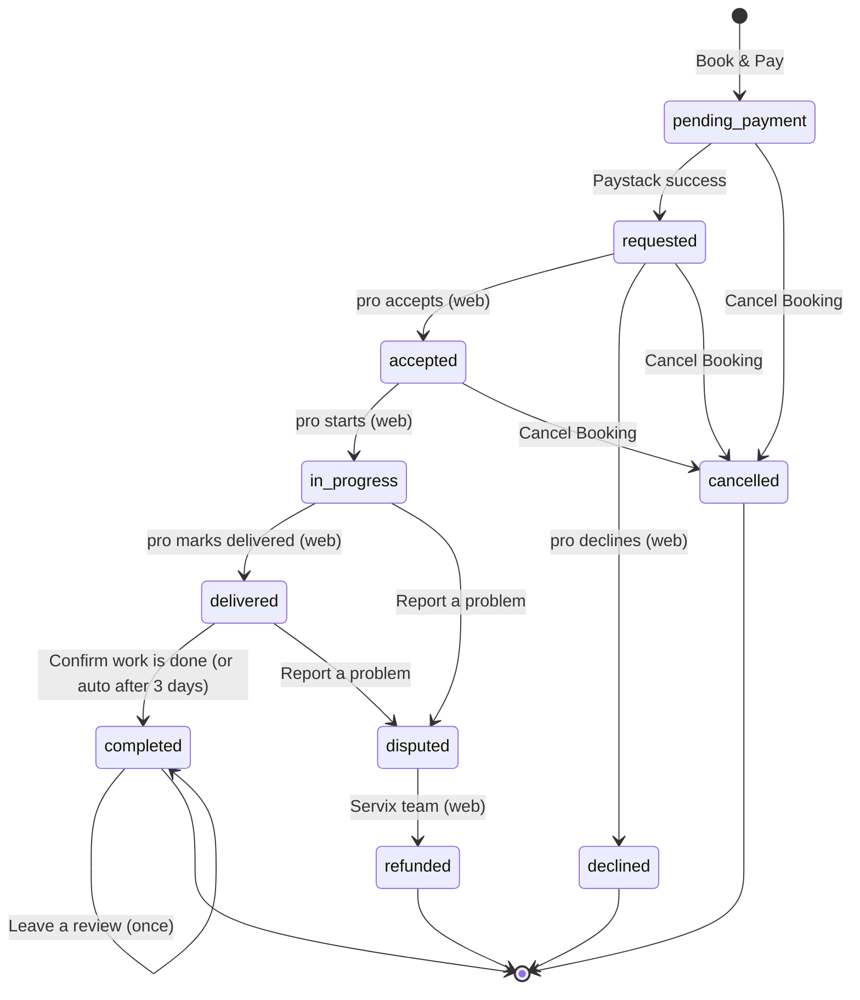
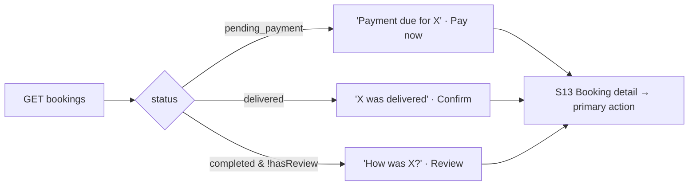
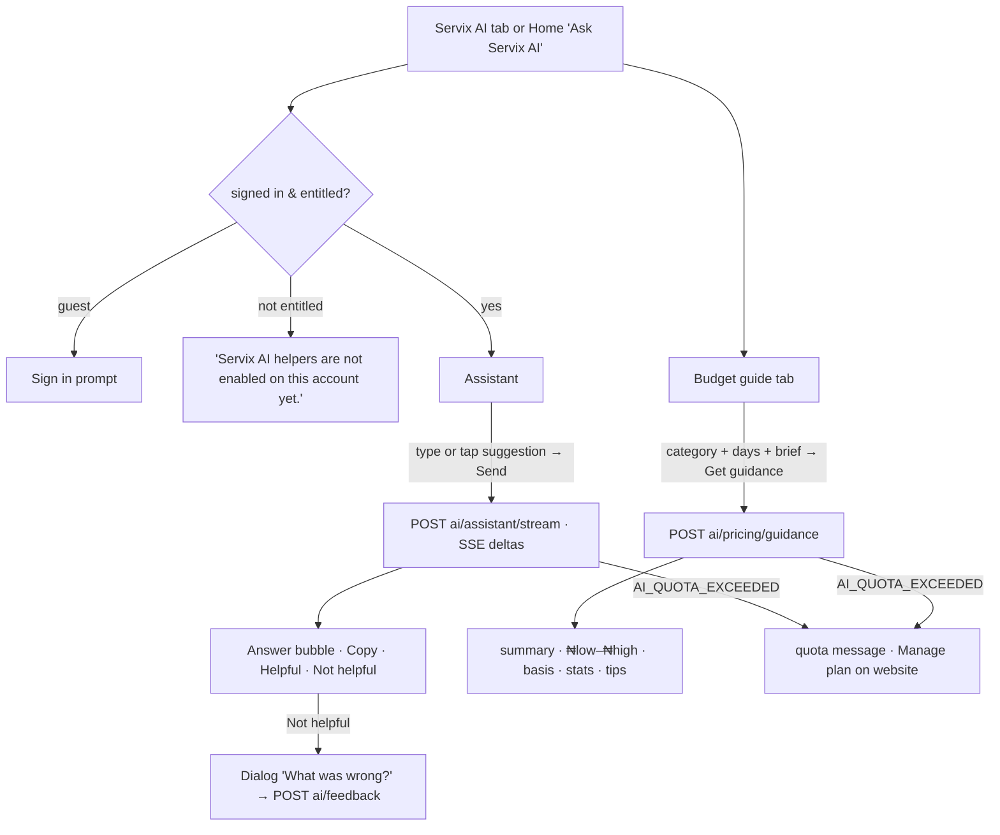

# User Journeys

All journeys below are implemented on `main` (`61a1c83`) unless marked. Screen IDs (S1…S16) refer
to `SCREEN_SPECIFICATIONS.md`.

## J1 · First run → account → dashboard

Evidence: `ServixAppShell.kt:464-640`, `AuthViewModel.kt`, `AndroidManifest.xml` intent filters.

## J2 · Find a professional and book (customer)

Evidence: `ServiceDetailScreen.kt:980-1240`, `BookingDetailScreen.kt:200-300`,
`util/CustomTabLauncher.kt`.

## J3 · Booking lifecycle from the customer's seat

App-side actions: `bookingActionsFor` (`BookingDetailScreen.kt:1186-1218`). Transitions marked
"(web)" happen on the professional's web workspace; the app only observes them.

## J4 · Needs-attention loop on Home

Evidence: `HomeViewModel.kt:58-80`; max three cards.

## J5 · Re-book a past booking

S13 (completed / cancelled / declined) → **Book again** → `GET bookings/{id}/rebook` → Re-book
modal (professional, services with "was booked" marker, previous notes) → S11 with
`rebookedFrom`, `initialNotes`, `openBookingSheet=true` → sheet titled "Book again" → J2 from
"Book & Pay". Evidence: `BookingDetailScreen.kt:1557`, `ServixRoutes.kt` `ServiceDetail` params.

## J6 · Servix AI

Evidence: `AiScreen.kt`, `AiViewModel.kt`, `AiRepository.kt`.

## J7 · Notifications

Sign-in → `NotificationsWorker.schedule` (15 min) → `GET account/notifications/unread` → local
notification (channel "Bookings & account") → tap → `servix://booking/{id}` or
`servix://notifications` → `AppLinkBus` → S13 or S15. In-app: bell badge on Home → S15 → tap row
→ mark read → booking. Evidence: `notifications/*`, `ServixAppShell.kt:338-345, 989-1005`.

## J8 · Account maintenance

S16 → Profile (name, photo) · Saved (remove) · Plan (read) · Security (read) · This device
(device/IP/location) · Updates · Legal → **Sign out** (`POST auth/logout`, clears tokens, back to
Welcome). Anything else → "Manage account on the website" (Custom Tab).

## J9 · Password recovery

S3 → **Forgot password?** → S7 → `POST auth/forgot-password` → "Check your inbox" (link, 30 min).
If the API answers with a security flow the app enters S6 `reset_password` with the live password
checklist. Evidence: `ServixAppShell.kt:619-640`, `AuthScreens.kt:1661`.

## J10 · Self-update (test channel only)

Shell `rememberUpdateUiState()` → on resume, at most once per 6 hours unless forced (`Updates.kt:87`), `GET
api.github.com/repos/toluenetech-spec/servix-android/releases` → if a newer `v<semver>-b<n>` with an
`.apk` asset exists → `UpdateCard` "Update available — Servix v{x}" → **Update** → DownloadManager
→ `FileProvider` install ("Allow installs from Servix…") → installs over the old version.
Play builds have `SELF_UPDATE_CHANNEL = "none"`. Evidence: `updates/Updates.kt`,
`updates/UpdateUi.kt`, `app/build.gradle.kts:60-67`.

## Journeys that do **not** exist in the app (⚪ platform-only)

Professional accepting/declining/delivering a job; creating or editing gigs; availability
management; earnings/payouts; chat with a professional; posting a job request; sending proposals;
connections; plan upgrade/checkout; password/MFA management; admin moderation. All are web-only
(`USER_ROLES_AND_PERMISSIONS.md`, `FEATURE_CATALOG.md`).
